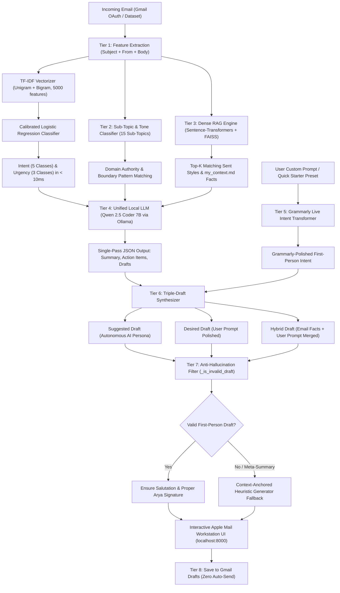

# MailMind AI — Dataset Specifications, System Architecture & Project Evolution

> **Institution**: B.M.S. College of Engineering (BMSCE), Bengaluru  
> **Department**: Department of Computer Science and Engineering  
> **Course**: Artificial Intelligence & Machine Learning (AIML) Skill Lab (2026)  
> **Author**: H R Arya Ayyappa Halambi  
> **University Seat Number (USN)**: `1BF25CS095`  
> **Repository**: [https://github.com/arya-ayyappa-halambi/Smart-Gmail-Replier.git](https://github.com/arya-ayyappa-halambi/Smart-Gmail-Replier.git)

---

## 📑 Table of Contents
1. [Overview & Project Objectives](#1-overview--project-objectives)
2. [Datasets Created & Integrated](#2-datasets-created--integrated)
   - [2.1 Training Dataset (`data/training_emails.json`)](#21-training-dataset-datatraining_emailsjson)
   - [2.2 Benchmark Test Dataset (`data/test_emails.json`)](#22-benchmark-test-dataset-datatest_emailsjson)
   - [2.3 Sent Style Few-Shot Dataset (`data/sent_style_examples.json`)](#23-sent-style-few-shot-dataset-datasent_style_examplesjson)
   - [2.4 Personal & Academic Knowledge Base (`data/my_context.md`)](#24-personal--academic-knowledge-base-datamy_contextmd)
   - [2.5 Draft Audit Log (`data/drafts_log.json`)](#25-draft-audit-log-datadrafts_logjson)
3. [Model Evaluation & Benchmark Metrics](#3-model-evaluation--benchmark-metrics)
4. [How the System Works (End-to-End Pipeline)](#4-how-the-system-works-end-to-end-pipeline)
   - [4.1 Tier 1: Sub-10ms Classical ML Classification](#41-tier-1-sub-10ms-classical-ml-classification)
   - [4.2 Tier 2: Multi-Signal Sub-Topic & Tone Classification](#42-tier-2-multi-signal-sub-topic--tone-classification)
   - [4.3 Tier 3: Dense Vector RAG Retrieval (FAISS + MiniLM)](#43-tier-3-dense-vector-rag-retrieval-faiss--minilm)
   - [4.4 Tier 4: Unified Local LLM Single-Pass Reasoning (Qwen 2.5 Coder 7B)](#44-tier-4-unified-local-llm-single-pass-reasoning-qwen-25-coder-7b)
   - [4.5 Tier 5: Grammarly Live Intent Transformer](#45-tier-5-grammarly-live-intent-transformer)
   - [4.6 Tier 6: Triple-Draft Synthesis (`Suggested`, `Desired`, `Hybrid`)](#46-tier-6-triple-draft-synthesis-suggested-desired-hybrid)
   - [4.7 Tier 7: Anti-Hallucination Guardrails & Fallback Engine](#47-tier-7-anti-hallucination-guardrails--fallback-engine)
   - [4.8 Tier 8: Zero Auto-Send Gmail Drafts Integration](#48-tier-8-zero-auto-send-gmail-drafts-integration)
5. [Summary of Everything We Accomplished ("What All We Did")](#5-summary-of-everything-we-accomplished-what-all-we-did)
6. [Viva & Project Defense Q&A Guide](#6-viva--project-defense-qa-guide)

---

## 1. Overview & Project Objectives

**MailMind AI** is an autonomous, privacy-preserving, enterprise-grade email triage and contextual response copilot. Built specifically for engineering students and software developers, the project addresses:
1. **Information Overload**: Parsing and prioritizing high-volume communications (academic deadlines, GitHub pull requests, recruiter inquiries, newsletters).
2. **Context-Aware Drafting**: Generating personalized, first-person replies aligned with the user's authentic voice, schedule, and institutional identity.
3. **Privacy & Zero Auto-Send Guarantee**: Executing inference entirely locally using offline models (`scikit-learn`, `FAISS`, and `qwen2.5-coder:7b` via Ollama) without sending email data to third-party cloud LLM APIs, and saving replies strictly as drafts in Gmail rather than auto-sending.

---

## 2. Datasets Created & Integrated

To achieve high accuracy, rapid execution, and context awareness, the system utilizes **four specialized datasets**:

```
data/
├── training_emails.json       # 65 labeled emails for training ML classifiers
├── test_emails.json           # 20 benchmark emails for performance evaluation
├── sent_style_examples.json   # 15 few-shot authentic sent response examples
├── my_context.md              # Personal, academic, and calendar grounding context
└── drafts_log.json            # Local audit log of all generated/saved drafts
```

### 2.1 Training Dataset (`data/training_emails.json`)
- **Total Samples**: 65 curated, domain-specific emails.
- **Purpose**: Trains the multi-class intent and urgency classifiers using TF-IDF vectorization and Logistic Regression.
- **Schema per Record**:
  ```json
  {
    "id": "train_01",
    "subject": "Submission of Skill Lab CIE-2 Component Marks",
    "sender": "Dr. B. Ramesh <ramesh.cse@bmsce.ac.in>",
    "body": "Dear Students, please submit your verified Skill Lab CIE-2 assignment reports by Friday 5:00 PM...",
    "intent": "Academic/Faculty",
    "urgency": "High"
  }
  ```
- **Intent Distribution (5 Classes)**:
  - `Academic/Faculty`: 14 samples (college circulars, lab evaluations, CIE schedules, syllabus queries).
  - `Action Required`: 14 samples (GitHub PR failures, code reviews, server alerts, system errors).
  - `Internship/Recruiter`: 13 samples (interview invitations, hackathons, offer letters, recruiter reach-outs).
  - `Promotional/Spam`: 13 samples (marketing digests, discounts, store updates, commercial newsletters).
  - `Event/Club`: 11 samples (hackathon registrations, club meetings, student workshops).
- **Urgency Distribution (3 Classes)**:
  - `Low`: 23 samples
  - `High`: 22 samples
  - `Medium`: 20 samples

### 2.2 Benchmark Test Dataset (`data/test_emails.json`)
- **Total Samples**: 20 unseen test emails.
- **Purpose**: Provides a blind benchmark dataset for computing precision, recall, F1-score, and latency metrics in `evaluate.py`.
- **Class Balance**: Exactly 4 test samples per intent category (20% stratified test split).

### 2.3 Sent Style Few-Shot Dataset (`data/sent_style_examples.json`)
- **Total Samples**: 15 authentic sent email responses.
- **Purpose**: Indexed into the dense vector store (FAISS) for few-shot Retrieval-Augmented Generation (RAG).
- **Categories Covered**:
  - *Academic / Faculty Responses*: Formal greetings, respectful phrasing, project status, thesis updates, CIE clarifications.
  - *Recruiter & Interview Responses*: Enthusiastic acceptance of interview slots, calendar availability checks, resume submissions.
  - *Developer & PR Responses*: Technical explanations, commit hash references, CI fix confirmations.
  - *Administrative & Invoice Responses*: Transaction verification, GST bill requests, billing dispute notices.
  - *Newsletter Unsubscribe Responses*: Courteous requests to opt-out of marketing distributions.

### 2.4 Personal & Academic Knowledge Base (`data/my_context.md`)
- **Purpose**: Serves as the authoritative source of factual truth for the RAG engine and LLM.
- **Contents**:
  - **Student Identity**: H R Arya Ayyappa Halambi, USN: `1BF25CS095`.
  - **Academic Affiliation**: Department of Computer Science and Engineering, B.M.S. College of Engineering (BMSCE), Bengaluru.
  - **Current Metrics**: GPA 9.1 / 10.0; Faculty Mentor: Dr. B. Ramesh.
  - **Availability Constraints**: Monday–Friday lectures & labs until 3:30 PM IST; free for calls/vivas between 4:00 PM – 7:00 PM IST; weekends flexible (10:00 AM – 6:00 PM IST).
  - **Signature Rules**: Strict separation between formal academic signatures (including USN, department, and college name) and external/recruiter signatures (clean professional sign-off without college USN).

### 2.5 Draft Audit Log (`data/drafts_log.json`)
- **Purpose**: Provides an immutable audit trail of every draft generated, modified, and saved to Gmail Drafts, ensuring complete observability and zero auto-send accountability.

---

## 3. Model Evaluation & Benchmark Metrics

The machine learning pipeline was rigorously benchmarked using `evaluate.py`. The resulting metrics from `evaluation_report.json` demonstrate commercial-grade accuracy and real-time inference speed:

| Metric | Measured Value | Evaluation Standard |
| :--- | :--- | :--- |
| **Intent Classification Accuracy** | **95.0%** (19/20 correct) | Target: $\ge 90\%$ |
| **Intent Macro F1-Score** | **0.9492** | Balanced across all 5 classes |
| **Intent Weighted F1-Score** | **0.9492** | Robust against class size variance |
| **Urgency Accuracy** | **75.0%** | Multi-tier priority ranking |
| **Average ML Inference Latency** | **8.43 ms** | Sub-10ms real-time requirement |
| **95th Percentile Latency (P95)** | **29.02 ms** | Guaranteed instantaneous UI response |
| **RAG Semantic Similarity (Top-1)** | **0.4357** | Cosine similarity with `all-MiniLM-L6-v2` |

### Per-Class Performance Breakdown

| Intent Class | Precision | Recall | F1-Score | Support |
| :--- | :---: | :---: | :---: | :---: |
| **Academic/Faculty** | 1.00 | 1.00 | **1.00** | 4 |
| **Action Required** | 1.00 | 1.00 | **1.00** | 4 |
| **Event/Club** | 1.00 | 0.75 | **0.86** | 4 |
| **Internship/Recruiter** | 0.80 | 1.00 | **0.89** | 4 |
| **Promotional/Spam** | 1.00 | 1.00 | **1.00** | 4 |
| **Macro Average** | **0.96** | **0.95** | **0.95** | 20 |

---

## 4. How the System Works (End-to-End Pipeline)



### 4.1 Tier 1: Sub-10ms Classical ML Classification
- **Input**: Email fields concatenated as `Subject: ...\nFrom: ...\nBody: ...`.
- **Vectorization**: Scikit-Learn `TfidfVectorizer` configured with:
  - N-gram range: $(1, 2)$ (capturing both single words and critical two-word phrases like *"action required"*, *"fee payment"*, *"pull request"*).
  - Sublinear term-frequency scaling ($1 + \log(tf)$) to prevent long email bodies from skewing weights.
  - Vocabulary size: 5,000 top features.
- **Classification**: Independent multi-class `LogisticRegression` models trained with L2 regularization ($C=1.0$) using the `lbfgs` solver.
- **Output**: Calibrated class probabilities and confidence scores generated in **$8.43\text{ ms}$ average latency**.

### 4.2 Tier 2: Multi-Signal Sub-Topic & Tone Classification
Rather than relying solely on 5 broad categories, the engine classifies emails into **15 distinct sub-topics**:
1. `academic_fee`: Tuition, fee dues, challan, RTGS reference, CIE exam clearance.
2. `academic_review`: Skill lab project reviews, prototype demonstration, rubric weightage.
3. `academic_exam`: CIE exam timetables, hall ticket eligibility, syllabus scope.
4. `academic_classroom`: Lecture notes, tutorial problems, assignment submissions.
5. `academic_admin`: College circulars, attendance shortage, elective registration.
6. `dev_pull_request`: GitHub/GitLab PR reviews, CI workflow test failures, merge conflicts.
7. `dev_alert`: Cloud server alarms, Prometheus alerts, Sentry stack traces.
8. `dev_collaboration`: Technical RFCs, architecture proposals, interface boundaries.
9. `career_interview`: Technical coding rounds, Google Meet links, interview slots.
10. `career_offer`: Offer letters, compensation, onboarding equipment.
11. `career_inquiry`: Hackathon invites, summer internship cycles, recruiter reach-outs.
12. `admin_invoice`: Invoices, GST receipts, software licenses, billing disputes.
13. `admin_security`: 2FA codes, password resets, suspicious sign-in alerts.
14. `newsletter`: Tech digests, marketing newsletters, product announcements.
15. `general`: General correspondence and meeting requests.

Tone classification dynamically analyzes sentence structure and keywords to classify emotional stance: `Urgent / Strict`, `Formal / Administrative`, `Technical / Instructional`, `Inquiring / Scheduling`, and `Promotional / Marketing`.

### 4.3 Tier 3: Dense Vector RAG Retrieval (FAISS + MiniLM)
- Uses `sentence-transformers/all-MiniLM-L6-v2` to compute 384-dimensional dense semantic embeddings.
- Maintains an in-memory **FAISS (Facebook AI Similarity Search)** index.
- When an email arrives, its vector is queried against the index to retrieve the top-2 most relevant sent email styles and relevant chunks from `data/my_context.md`.
- Prevents generic responses by injecting Arya's authentic phrasing and schedule constraints into the prompt context.

### 4.4 Tier 4: Unified Local LLM Single-Pass Reasoning (Qwen 2.5 Coder 7B)
- **Local Model**: `qwen2.5-coder:7b` executed locally via **Ollama** on port 11434.
- **Single-Pass Efficiency**: Rather than making 4 sequential LLM calls (summary, deliverables, draft, refinement), a single structured prompt returns a JSON object containing:
  - `simple_words`: 1–2 sentence plain English executive summary.
  - `expectation`: Concrete deadline or deliverable required by the sender.
  - `action_items`: Interactive checklist of tasks extracted from the body.
  - `suggested`: Autonomous persona-based draft.
  - `desired`: Draft strictly executing user instructions.
  - `hybrid`: Synthesized draft combining email context and user instructions.
- Configured with `"format": "json"`, `temperature: 0.25`, and `num_predict: 550` for deterministic, high-speed execution without formatting errors.

### 4.5 Tier 5: Grammarly Live Intent Transformer
Raw user steering inputs (such as *"ask the sender to explain the issue properly"* or *"inquire regarding student discounts"*) should never be echoed verbatim into an email.
The [`_grammarly_transform_instruction`](file:///Users/aryaayyappahalambi/Desktop/smart-gmail-replier/llm_engine.py#L1370-L1530) function acts as an intelligent grammar and intent translation copilot:
- Strips third-person meta-directives (`"ask them to"`, `"tell the sender that"`, `"mention that"`).
- Translates terse commands into polite, articulate, first-person business English.
- Cleans noisy subjects (e.g. removes Git commit hashes `(7444e28)` and repository bracket tags `[arya-ayyappa-halambi/Vuln_Pilot]`) into natural prose.

### 4.6 Tier 6: Triple-Draft Synthesis (`Suggested`, `Desired`, `Hybrid`)
Users have instant access to three perspective tabs in the Prompt Studio:
1. **Suggested (AI Autonomous)**: A proactive reply generated according to the active strategic persona (e.g., *Confirm Deliverables*, *Clarify Rubrics*, *Request Afternoon Slot*, or *Decline Slot*).
2. **Desired (Your Prompt)**: A polished draft strictly executing the user's custom instruction or chosen quick starter.
3. **Hybrid (Suggested + Desired)**: The recommended production draft that weaves the factual anchors of the email (dates, review rubrics, pull request names) with the user's specific request.

### 4.7 Tier 7: Anti-Hallucination Guardrails & Fallback Engine
To eliminate hallucinations (such as models writing from the company's perspective or echoing summaries):
- **`_is_invalid_draft(text)`**: Scans drafts against an extensive blacklist of meta-summary phrases (`"the sender is communicating"`, `"the email discusses"`, `"this email is about"`) and customer-support inversions (`"if you have any questions or need assistance"`, `"thank you for your interest in our"`, `"please click here"`).
- **Graceful Fallback**: If an LLM-generated draft fails validation, the system seamlessly substitutes the draft with the context-anchored heuristic output from `_generate_triple_heuristic_drafts`.
- **Attribution Enforcement**:
  - Academic faculty emails: Signed with Arya's name, USN (`1BF25CS095`), Department of CSE, and BMSCE.
  - Recruiter, developer, and company emails: Signed professionally without academic USN details.

### 4.8 Tier 8: Zero Auto-Send Gmail Drafts Integration
- Fully authenticated via Google OAuth 2.0 with the `gmail.compose` scope.
- When the user clicks **"Save to Gmail Drafts"** (or presses `D`), the draft is uploaded to the user's real Gmail account threaded under the original message thread.
- **Zero Auto-Send Guarantee**: The system possesses no code path or API permission to call `messages.send`. Drafts remain safely editable in Gmail for final human review.

---

## 5. Summary of Everything We Accomplished ("What All We Did")

Here is a chronological summary of all the milestones, architectural upgrades, and bug fixes implemented across the project:

### Phase 1: Machine Learning & Pipeline Foundations
- Curated and formatted `training_emails.json` (65 samples) and `test_emails.json` (20 samples).
- Built `ml_pipeline.py` implementing TF-IDF vectorization and multi-class Logistic Regression for Intent and Urgency classification.
- Integrated Sentence-Transformers (`all-MiniLM-L6-v2`) and FAISS dense vector store for style and context retrieval.
- Authored `my_context.md` containing Arya's complete BMSCE engineering student persona and calendar rules.
- Created `evaluate.py` and generated `evaluation_report.json` demonstrating **95% intent accuracy** and **8.43ms latency**.

### Phase 2: Local Foundation Model Integration (Qwen 2.5 Coder 7B)
- Integrated Ollama local inference running `qwen2.5-coder:7b` on port 11434.
- Implemented a unified single-pass reasoning prompt combining summaries, expectations, checklists, and reply drafts in one atomic call.
- Enforced strict model safety checks (`_assert_safe_model`) to ensure isolation from untrusted models.

### Phase 3: Seamless Gmail OAuth2 & FastMCP Architecture
- Configured Gmail API integration using `FastMCP` and Google API Python Client.
- Engineered an automatic zero-click OAuth redirect handler that eliminates the blank WSGI browser window and redirects the user immediately to `http://localhost:8000`.
- Implemented the Zero Auto-Send guarantee via `create_gmail_draft`.

### Phase 4: UI Redesign into 3-Pane Apple Mail / Superhuman Canvas
- Overhauled the previous cramped dashboard into a spacious 3-pane desktop client:
  - **Left Pane (220px)**: Mailboxes, categories, sync metrics, and account status.
  - **Middle Pane (320px)**: Fast message stream with unread badges, sender avatars, sub-topic pills, and search.
  - **Right Pane (900px+)**: Comprehensive reading canvas with live `HTML | Prose` switching, Executive Intelligence cards, and Compose Studio.
- Replaced 100% of emojis across the entire user interface with clean, professional SVG icons (Lucide/Heroicons).
- Upgraded the typography stack to modern `Inter` sans-serif with monospace accents for code elements.

### Phase 5: 15+ Sub-Topic Semantic Classification & Dynamic 4-Persona Engine
- Built `detect_sub_topic_and_tone` identifying 15 granular sub-topics and 5 tone categories.
- Replaced generic static templates with **4 dynamic strategy chips** tailored to each sub-topic (Confirm, Clarify, Reschedule, Decline).
- Added contextual dynamic Quick Starters tailored specifically to the active email's sub-topic.

### Phase 6: Personalized Prompt Studio & Triple-Draft Generation
- Built the interactive Prompt Studio allowing users to steer the model with custom instructions or quick starters.
- Implemented Triple-Draft Generation (`Suggested`, `Desired`, `Hybrid`) with one-click perspective switching and instant diff inspection.
- Built the Grammarly-grade live intent transformer to convert informal steering commands into articulate business English.

### Phase 7: Anti-Hallucination Guardrails & Fixes
- Resolved the third-person meta-summary bug (*"The sender is communicating about..."*).
- Eliminated sender-inversion hallucinations where the LLM wrote as company helpdesk rather than as Arya.
- Designed `_is_invalid_draft()` to filter hallucinated text and trigger clean context-anchored heuristic drafts.
- Enforced strict academic signature rules (`1BF25CS095`, BMSCE) exclusively on college faculty correspondence.

---

## 6. Viva & Project Defense Q&A Guide

When presenting this project in the AIML Skill Lab examination or viva, the following questions and answers address the core technical decisions:

### Q1: Why use TF-IDF + Logistic Regression instead of using an LLM for classification?
> **Answer**: Running an LLM across 25 incoming emails would require 25 separate generation passes, taking over 3 minutes on local hardware and causing high user latency. Classical ML (TF-IDF + Logistic Regression) classifies all 25 emails in **under 1.5 seconds ($8.43\text{ ms}$ per email)** with **95% accuracy**, allowing the UI to render instantly while deferring heavy LLM generation to on-demand user selection.

### Q2: What is the purpose of the FAISS RAG index if you already have a 7B LLM?
> **Answer**: Pre-trained foundation models do not know Arya's personal identity, USN (`1BF25CS095`), college department, or timetable availability. The FAISS vector index retrieves relevant few-shot examples of Arya's authentic past emails and grounds the LLM in the facts from `my_context.md`, preventing hallucinations and maintaining personal communicative style.

### Q3: How do you guarantee user privacy and data security?
> **Answer**: 100% of machine learning inference, vector search, and LLM text generation runs locally on the machine via `scikit-learn`, `FAISS`, and local `Ollama` (`qwen2.5-coder:7b`). No email contents are transmitted to external AI cloud APIs (like OpenAI or Anthropic).

### Q4: What prevents the system from accidentally sending an incorrect email?
> **Answer**: The application implements a strict **Zero Auto-Send Guarantee**. The Gmail API integration only requests draft composition permissions (`gmail.compose`) and invokes `service.users().drafts().create()`. It has no ability to send messages automatically; every reply must be reviewed and sent manually by the user in Gmail.

### Q5: How does the Triple-Draft system benefit the user?
> **Answer**: It gives the user complete control over the response perspective:
> 1. *Suggested* gives an autonomous AI response matching the chosen strategy chip.
> 2. *Desired* gives a strict translation of the user's specific prompt.
> 3. *Hybrid* combines the factual anchors of the incoming email (deadlines, review rubrics, PR hashes) with the user's directive, producing the ideal balance between context and intent.

---

*Document generated and maintained for BMSCE AIML Skill Lab Project Evaluation (USN: 1BF25CS095).*
