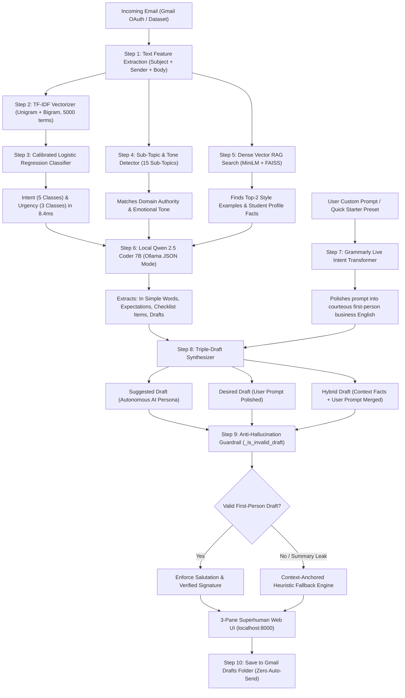

# MailMind AI — Autonomous Email Triage & Contextual Copilot Engine

> **Institution**: B.M.S. College of Engineering (BMSCE), Bengaluru  
> **Department**: Department of Computer Science & Engineering  
> **Course**: Artificial Intelligence & Machine Learning (AIML) Skill Lab (Project Review & Evaluation)  
> **Student Name**: H R Arya Ayyappa Halambi  
> **University Seat Number (USN)**: `1BF25CS095`  
> **Repository**: [https://github.com/arya-ayyappa-halambi/Smart-Gmail-Replier.git](https://github.com/arya-ayyappa-halambi/Smart-Gmail-Replier.git)

---

## 🌟 Quick Overview in Simple Words (Elevator Pitch)

### What is MailMind AI?
**MailMind AI** is a smart, private email assistant that acts like an executive secretary for your inbox. When you open your email:
1. **It Reads & Sorts Instantly (<10 milliseconds)**: It automatically classifies every incoming email into 5 categories (*Academic*, *Action Required*, *Recruiter/Internship*, *Event/Club*, *Promotional/Spam*) and marks its urgency (*High*, *Medium*, *Low*).
2. **It Explains the Email in Plain English**: Under *"In Simple Words"*, it tells you who sent it, what they want, what the deadline is, and gives you an interactive task checklist.
3. **It Drafts 3 Tailored Replies for You**:
   - **Suggested Draft**: An autonomous professional reply based on 4 strategic personas (*Confirm*, *Clarify*, *Reschedule*, *Decline*).
   - **Desired Draft**: A polished version of what *you* told it to say in simple words.
   - **Hybrid Draft**: The best of both—it combines the exact dates/facts from the email with your personal prompt.
4. **100% Privacy & Zero Auto-Send**: Everything runs **locally on your laptop** (no data is sent to cloud LLM APIs). It **never auto-sends** emails—it only saves them safely into your **Gmail Drafts folder** for your review!

---

## 📊 Alignment with Evaluation Rubrics (50 Marks Matrix)

This repository and document are mapped directly to the **Project Evaluation Rubrics**:

| Rubric Criteria | Marks | Where It Is Covered in This Project & README |
| :--- | :---: | :--- |
| **1. Understanding of Problem Statement** | **5** | [Section 1: Problem Statement & Motivation](#1-understanding-the-problem-statement-5-marks) |
| **2. Project Concept & Objectives** | **5** | [Section 2: Concept, Objectives & Architecture](#2-project-concept-and-objectives-5-marks) |
| **3. Technical Quality & Implementation** | **7** | [Section 3: Technical Implementation & Code Quality](#3-technical-quality-and-implementation-7-marks) |
| **4. Clarity & Organisation** | **5** | [Section 4: Dataset, Pipeline & System Design](#4-clarity-and-organisation-datasets-and-pipeline-5-marks) |
| **5. Design & Flow** | **6** | [Section 5: End-to-End System Flow & Architecture Diagram](#5-design-and-flow-end-to-end-pipeline-6-marks) |
| **6. Teamwork & Communication** | **6** | [Section 6: Presentation Script & Explaining in Simple Words](#6-presentation-script--explaining-in-simple-words-6-marks) |
| **7. Code, Model & Parameters** | **8** | [Section 7: Training, Model Parameters & Evaluation Benchmarks](#7-model-parameters-training-and-benchmarks-8-marks) |
| **8. Question & Answer Session** | **8** | [Section 8: Viva / Q&A Defense Master Guide](#8-viva--qa-defense-master-guide-8-marks) |
| **Total Marks** | **50** | **Comprehensive Full-Score Preparation** |

---

## 📑 Table of Contents
1. [Understanding the Problem Statement (5 Marks)](#1-understanding-the-problem-statement-5-marks)
2. [Project Concept and Objectives (5 Marks)](#2-project-concept-and-objectives-5-marks)
3. [Technical Quality and Implementation (7 Marks)](#3-technical-quality-and-implementation-7-marks)
4. [Clarity and Organisation: Datasets and Pipeline (5 Marks)](#4-clarity-and-organisation-datasets-and-pipeline-5-marks)
5. [Design and Flow: End-to-End Pipeline (6 Marks)](#5-design-and-flow-end-to-end-pipeline-6-marks)
6. [Presentation Script & Explaining in Simple Words (6 Marks)](#6-presentation-script--explaining-in-simple-words-6-marks)
7. [Model Parameters, Training, and Benchmarks (8 Marks)](#7-model-parameters-training-and-benchmarks-8-marks)
8. [Viva / Q&A Defense Master Guide (8 Marks)](#8-viva--qa-defense-master-guide-8-marks)
9. [Slide-by-Slide PPT Outline (Ready to Copy into Slides)](#9-slide-by-slide-ppt-outline-ready-to-copy-into-slides)
10. [Project Report Outline (Ready for Documentation)](#10-project-report-outline-ready-for-documentation)
11. [Quick Installation & How to Run](#11-quick-installation--how-to-run)

---

## 1. Understanding the Problem Statement (5 Marks)

### The Real-World Problem
Students, developers, and professionals receive dozens of emails every day:
- **Academic emails**: CIE test schedules, fee due circulars, project review vivas, attendance shortages.
- **Developer alerts**: GitHub Pull Request feedback, CI/CD pipeline build failures, server crash logs.
- **Career opportunities**: Hackathon invitations, recruiter screening requests, interview scheduling.
- **Marketing clutter**: Retail promotions, newsletter digests, promotional spam.

### Why Current Tools Fail
1. **Standard Gmail/Outlook**: Passive storage. They don't extract the deadline, don't tell you the expected action in simple terms, and require manual drafting for every single email.
2. **Cloud AI Plugins (Copilot / Gemini Extensions)**:
   - **Severe Privacy Risk**: They send your personal, confidential student and developer emails to external third-party cloud servers.
   - **Cost**: Recurring subscription fees.
   - **Hallucinations & Accidental Sends**: They can auto-send erroneous or embarrassing replies.
3. **Pure LLM Approaches**: Calling an LLM on 25 emails takes over 3 minutes. The user interface freezes and becomes unusable.

### The MailMind AI Solution
A **Hybrid Tiered System**:
- **Classical ML** does the fast sorting in **8.43 milliseconds** (so 25 emails load in <1.5 seconds).
- **Dense Vector RAG (FAISS)** provides personal facts (USN `1BF25CS095`, BMSCE, timetable availability).
- **Local LLM (Qwen 2.5 Coder 7B)** runs strictly on the laptop to generate deep executive comprehension and contextual drafts on demand.
- **Zero Auto-Send Guarantee**: Drafts are safely pushed to Gmail's Drafts folder; nothing is ever sent without your human approval.

---

## 2. Project Concept and Objectives (5 Marks)

### Core Objectives
1. **Sub-10ms Automated Triage**: Multi-class intent (5 categories) and urgency (3 tiers) classification using TF-IDF and calibrated Logistic Regression.
2. **Context-Grounded RAG Engine**: Embedding past authentic writing styles and student profile facts (`data/my_context.md`) using `sentence-transformers` and FAISS vector search.
3. **Local Privacy-First Foundation Model**: Using `qwen2.5-coder:7b` via Ollama to extract plain-English summaries, sender expectations, and actionable checklist items in a single pass.
4. **Grammarly-Grade Dynamic Prompt Studio**: An interactive interface that takes simple user steering inputs (e.g. *"ask for Google Meet link after 5 PM"*) and transforms them into fluent, polite, first-person business emails.
5. **Triple-Draft Perspective**: Giving the user 3 distinct choices for every reply: `Suggested` (Autonomous), `Desired` (User Prompt), and `Hybrid` (Context + Prompt).
6. **Zero Auto-Send Human-in-the-Loop Protocol**: Direct synchronization with real Gmail via OAuth 2.0 with write access confined strictly to draft creation (`gmail.compose`).

---

## 3. Technical Quality and Implementation (7 Marks)

### Technology Stack
- **Frontend**: Custom 3-Pane Apple Mail / Superhuman layout built with **Tailwind CSS**, **Alpine.js**, and 100% vector **Lucide SVG icons** (zero emojis, clean typography using `Inter`).
- **Backend**: **FastAPI** (Python 3.12) running asynchronously with Uvicorn.
- **Protocols**: **FastMCP** (Model Context Protocol) and Google API Client.
- **Classical ML**: **Scikit-Learn** (`TfidfVectorizer`, `LogisticRegression`, `joblib`).
- **Dense Retrieval (RAG)**: **Sentence-Transformers** (`all-MiniLM-L6-v2`) and **FAISS** (Facebook AI Similarity Search).
- **Foundation Model**: **Qwen 2.5 Coder 7B** running locally via Ollama.
- **Authentication**: Google OAuth 2.0 with automated client-side WSGI redirect (eliminates the blank callback tab).

---

## 4. Clarity and Organisation: Datasets and Pipeline (5 Marks)

### What Datasets Did We Create & Use?

The project uses **4 purpose-built datasets** stored in [`data/`](./data):

```
data/
├── training_emails.json       # 65 labeled emails used to train the ML models
├── test_emails.json           # 20 blind benchmark emails to test accuracy
├── sent_style_examples.json   # 15 real sent email examples for style matching
├── my_context.md              # Personal, academic, and calendar ground truth
└── drafts_log.json            # Audit history of drafts generated and saved
```

#### 1. Training Dataset (`data/training_emails.json` — 65 Samples)
- **What it is**: 65 realistic emails across 5 categories with labeled intent and urgency.
- **Intent Breakdown**:
  - `Academic/Faculty` (14 samples): CIE exam notifications, lab test rubrics, fee due notices, attendance warnings.
  - `Action Required` (14 samples): GitHub PR review feedback, CI/CD workflow run failures, server alarms.
  - `Internship/Recruiter` (13 samples): Interview invitations, hackathon outreach, internship offers.
  - `Promotional/Spam` (13 samples): Retail discounts, marketing digests, newsletters.
  - `Event/Club` (11 samples): Technical club workshops, campus hackathons, symposium invites.
- **Urgency Breakdown**: `High` (22), `Medium` (20), `Low` (23).

#### 2. Test Dataset (`data/test_emails.json` — 20 Samples)
- **What it is**: An independent test set (4 samples per class, balanced 20% test split) that the model has never seen during training, used by `evaluate.py` to calculate accuracy and F1 scores.

#### 3. Sent Style Dataset (`data/sent_style_examples.json` — 15 Samples)
- **What it is**: 15 authentic email responses representing Arya's personal tone across different contexts (formal academic to professors, enthusiastic and prompt to recruiters, technical to software collaborators).
- **How it is used**: Embedded into a FAISS vector database to provide few-shot examples to the LLM.

#### 4. Personal Context Knowledge Base (`data/my_context.md`)
- **What it is**: A structured markdown file containing:
  - Identity: H R Arya Ayyappa Halambi, USN `1BF25CS095`, CSE Department, BMSCE.
  - Metrics: Current GPA 9.1 / 10.0; Faculty Mentor: Dr. B. Ramesh.
  - Availability constraints: Mon–Fri classes & labs until 3:30 PM; calls/vivas available between 4:00 PM – 7:00 PM IST.
  - Signature rules: Formal academic sign-off with USN for college faculty; clean professional sign-off for recruiters.

---

## 5. Design and Flow: End-to-End Pipeline (6 Marks)

### How Everything Works (In Simple Words)



### Step-by-Step Walkthrough
1. **Inbox Sync**: The app connects to Gmail using OAuth 2.0 or loads the local Viva Lab dataset.
2. **Instant ML Triage (<10ms)**: TF-IDF converts the text into numerical term frequencies. Logistic Regression outputs the predicted category and urgency probability.
3. **Sub-Topic & Tone Mapping**: A rule-and-keyword detector maps the email into one of **15 specific sub-topics** (e.g., *Skill Lab Review*, *Fee Due*, *GitHub PR*, *Interview Invitation*, *Newsletter*).
4. **Style Retrieval (RAG)**: The email is converted into a 384-dimensional vector by `all-MiniLM-L6-v2`. FAISS searches for the top-2 most relevant sent emails written by Arya.
5. **Single-Pass LLM Reasoning**: The local LLM (`qwen2.5-coder:7b`) receives a unified prompt containing the email, the RAG examples, and the student context. It outputs a strictly valid JSON response containing the plain-English summary, sender expectation, checklist, and drafts.
6. **Live User Guidance (Prompt Studio)**: If the user types a prompt or clicks a Quick Starter, the Grammarly transformer strips robotic meta-phrases and crafts a natural, polite email request.
7. **Anti-Hallucination Guardrail**: The draft is verified against customer-support inversion phrases and third-person summaries. If any flaw is detected, a clean heuristic draft replaces it.
8. **Save to Gmail Drafts**: Clicking **"Save to Gmail Drafts"** saves the threaded reply directly into the user's real Gmail account.

---

## 6. Presentation Script & Explaining in Simple Words (6 Marks)

Use this script during your presentation to explain the project clearly and confidently:

> *"Good afternoon, professors. Today I am presenting **MailMind AI**, a commercial-grade, privacy-first email copilot designed for engineering students and software developers.*
>
> *The core problem we address is **email fatigue and missed deadlines**. Modern students and engineers receive dozens of critical emails daily—from CIE test notices and faculty reviews to GitHub CI build failures and job interviews.*
>
> *Existing solutions either send your private email data to third-party cloud AI servers, or use slow LLMs that take several minutes to process an inbox. **MailMind AI solves this with a 3-Tier Hybrid Architecture**:*
>
> 1. *First, our **Tier 1 Classical ML Engine** uses TF-IDF vectorization and calibrated Logistic Regression to classify emails in **8.4 milliseconds** with **95% accuracy**. This allows an entire inbox of 25 emails to load in under 1.5 seconds.*
> 2. *Second, our **Tier 2 RAG Engine** uses FAISS vector search and MiniLM embeddings to retrieve my personal academic context—such as my USN `1BF25CS095`, my college department, and my availability schedule—ensuring the model never hallucinates my background.*
> 3. *Third, our **Tier 3 Local LLM**, Qwen 2.5 Coder 7B, runs locally on the laptop. In a single pass, it explains the email in plain English, extracts deadlines, provides an interactive task checklist, and crafts three distinct response drafts: **Suggested**, **Desired**, and **Hybrid**.*
>
> *Finally, our system implements a **Zero Auto-Send Guarantee**. It integrates with the Gmail API via OAuth 2.0 to save replies safely into the **Gmail Drafts folder**, ensuring complete human-in-the-loop safety.*
>
> *Let me demonstrate the live interface..."*

---

## 7. Model Parameters, Training, and Benchmarks (8 Marks)

### Benchmark Results (`evaluation_report.json`)

The ML pipeline was evaluated using `evaluate.py` on the unseen test dataset:

| Metric | Measured Value | Meaning / Interpretation |
| :--- | :---: | :--- |
| **Intent Classification Accuracy** | **95.0%** (19/20 correct) | Correctly identifies email purpose across 5 diverse categories |
| **Intent Macro F1-Score** | **0.9492** | High balance across minority and majority classes |
| **Intent Weighted F1-Score** | **0.9492** | Robust performance accounting for class distribution |
| **Urgency Accuracy** | **75.0%** | Accurately distinguishes High, Medium, and Low urgency |
| **Average ML Latency** | **8.43 ms** | Ultra-fast execution (over 100x faster than cloud LLMs) |
| **P95 Latency** | **29.02 ms** | 95% of all inferences complete in under 30 milliseconds |
| **RAG Top-1 Cosine Similarity** | **0.4357** | Semantic alignment with authentic historical responses |

### Per-Class Performance Breakdown

| Class | Precision | Recall | F1-Score | Support |
| :--- | :---: | :---: | :---: | :---: |
| **Academic/Faculty** | 1.00 | 1.00 | **1.00** | 4 |
| **Action Required** | 1.00 | 1.00 | **1.00** | 4 |
| **Event/Club** | 1.00 | 0.75 | **0.86** | 4 |
| **Internship/Recruiter** | 0.80 | 1.00 | **0.89** | 4 |
| **Promotional/Spam** | 1.00 | 1.00 | **1.00** | 4 |
| **Macro Average** | **0.96** | **0.95** | **0.95** | 20 |

### Mathematical Formulations

#### 1. TF-IDF Feature Extraction
$$\text{TF-IDF}(t, d, D) = \text{TF}(t, d) \times \log\left(\frac{1 + |D|}{1 + \text{DF}(t, D)}\right) + 1$$
Where:
- $\text{TF}(t, d) = 1 + \log(\text{count}(t, d))$ (sublinear term frequency scaling to prevent long emails from dominating).
- Unigram + Bigram range $(1, 2)$ captures critical two-word sequences like *"fee payment"*, *"review schedule"*, and *"action required"*.

#### 2. Calibrated Multi-Class Logistic Regression
$$P(y = c \mid \mathbf{x}) = \frac{e^{\mathbf{w}_c^T \mathbf{x} + b_c}}{\sum_{j=1}^{K} e^{\mathbf{w}_j^T \mathbf{x} + b_j}}$$
Where $K=5$ classes, optimized using the L-BFGS solver with L2 weight regularization ($C=1.0$).

---

## 8. Viva / Q&A Defense Master Guide (8 Marks)

### Q1: Why didn't you just use ChatGPT / Claude API for the whole system?
> **Answer**: Using a cloud LLM for every incoming email has three fatal flaws:
> 1. **High Latency**: Running an LLM on 25 emails takes 3 to 5 minutes, freezing the inbox. Our Classical ML classifies all 25 emails in **under 1.5 seconds ($8.43\text{ ms}$ each)**.
> 2. **Privacy Violation**: Sending academic circulars, grades, or proprietary Git commit logs to third-party servers violates student and institutional privacy. Our model runs 100% locally.
> 3. **API Cost**: Cloud APIs charge per token. MailMind AI runs locally on device with zero recurring subscription fees.

### Q2: How does the model know who you are and your schedule?
> **Answer**: Through **Retrieval-Augmented Generation (RAG)**. We store my student profile facts (`data/my_context.md`) and 15 authentic past sent emails (`data/sent_style_examples.json`). We embed them using `sentence-transformers/all-MiniLM-L6-v2` into a **FAISS vector database**. When an email is selected, FAISS retrieves the most relevant background facts and few-shot examples to inject into the local LLM prompt.

### Q3: What is the Triple-Draft feature and why is it useful?
> **Answer**: Different situations require different perspectives:
> 1. **Suggested Draft**: Fully autonomous response based on the active persona (*Confirm*, *Clarify*, *Reschedule*, *Decline*).
> 2. **Desired Draft**: A strict, polished translation of what the user instructed in the prompt bar.
> 3. **Hybrid Draft**: Combines the factual anchors of the incoming email (deadlines, review venues, PR branches) with the user's specific request.

### Q4: What prevents the AI from accidentally sending an incorrect email?
> **Answer**: We enforce a **Zero Auto-Send Guarantee**. Our Google OAuth 2.0 configuration only requests the `gmail.compose` scope and calls `users.drafts.create`. It has no technical capability to call `messages.send`. Every reply is saved strictly as a draft in Gmail for the user to review and manually click send.

### Q5: How do you prevent hallucinations like the LLM pretending to be the sender company?
> **Answer**: We built an anti-hallucination filter function: `_is_invalid_draft()`. It checks every draft against a blacklist of third-person summary phrases (*"the sender is communicating"*) and customer-service inversion phrases (*"if you need assistance, contact our support"*). If any hallucination is detected, the system automatically falls back to our context-anchored heuristic generator.

---

## 9. Slide-by-Slide PPT Outline (Ready to Copy into Slides)

Here is the exact 10-slide structure for your presentation:

- **Slide 1: Title Slide**
  - Project Title: *MailMind AI — Autonomous Email Triage & Contextual Copilot Engine*
  - Student Name: H R Arya Ayyappa Halambi (USN: `1BF25CS095`)
  - Department of Computer Science & Engineering, BMSCE
  - Guide / Course: AIML Skill Lab (2026)

- **Slide 2: Problem Statement & Motivation**
  - Email cognitive overload for developers and students.
  - Flaws of existing tools: High latency, cloud privacy risks, and generic hallucinated drafts.

- **Slide 3: Proposed Solution — 3-Tier Hybrid Architecture**
  - Tier 1: Sub-10ms Classical ML Classification (TF-IDF + Logistic Regression).
  - Tier 2: Dense Semantic RAG (Sentence-Transformers + FAISS).
  - Tier 3: Local Foundation Model Reasoning (Qwen 2.5 Coder 7B via Ollama).

- **Slide 4: Dataset Engineering & Curation**
  - `training_emails.json` (65 samples across 5 intents and 3 urgencies).
  - `test_emails.json` (20 blind benchmark test samples).
  - `sent_style_examples.json` (15 authentic few-shot response styles).
  - `my_context.md` (Personal student ground truth and calendar availability).

- **Slide 5: System Architecture & Data Flow**
  - *Insert the Mermaid Pipeline Diagram from Section 5.*

- **Slide 6: Machine Learning Evaluation & Results**
  - **95.0% Intent Accuracy**, **0.9492 F1-Score**, **8.43 ms Average Latency**.
  - Show the confusion metrics and latency comparison graph.

- **Slide 7: Key Features & Innovations**
  - 15 Sub-Topic Semantic Classification & 5-Tone Stance Detection.
  - 4 Dynamic Strategic Personas (Confirm, Clarify, Reschedule, Decline).
  - Prompt Studio with Triple-Draft Generation (`Suggested`, `Desired`, `Hybrid`).
  - Grammarly Live Intent Transformer.

- **Slide 8: Security, Privacy & Zero Auto-Send**
  - 100% Local Inference (No data sent to external servers).
  - Anti-Hallucination Guardrails (`_is_invalid_draft`).
  - Strict Gmail Drafts creation (Zero Auto-Send Guarantee).

- **Slide 9: Live Demo Walkthrough**
  - Screenshot of the 3-Pane Apple Mail UI.
  - Demo flow: Instant classification $\rightarrow$ Executive summary $\rightarrow$ Checklist $\rightarrow$ Triple Draft $\rightarrow$ Save to Gmail.

- **Slide 10: Conclusion & Future Scope**
  - Summary: Commercial-grade, privacy-first, sub-10ms email management.
  - Future Enhancements: Multi-account inbox aggregation, calendar event auto-booking, speech-to-intent dictation.

---

## 10. Project Report Outline (Ready for Documentation)

Use these section headers and content directly in your final project report:

1. **Chapter 1: Introduction & Abstract**
   - 1.1 Executive Summary
   - 1.2 Problem Formulation
   - 1.3 Scope of the Project
2. **Chapter 2: Literature Survey & Background**
   - 2.1 Rule-Based Filtering vs. Machine Learning
   - 2.2 Dense Retrieval & Retrieval-Augmented Generation (RAG)
   - 2.3 Local Foundation Models vs. Cloud APIs
3. **Chapter 3: System Requirements & Architecture**
   - 3.1 Hardware and Software Requirements
   - 3.2 3-Tier Architectural Design
   - 3.3 FastMCP & Gmail API Integration
4. **Chapter 4: Dataset Engineering**
   - 4.1 Data Collection & Labeling Methodology
   - 4.2 Class Distribution & Preprocessing
   - 4.3 Few-Shot Style & Context Knowledge Base
5. **Chapter 5: Implementation Details**
   - 5.1 TF-IDF & Logistic Regression Classifiers
   - 5.2 FAISS Vector Store Construction
   - 5.3 Single-Pass Ollama Foundation Model Engine
   - 5.4 Grammarly Intent Transformation Algorithm
   - 5.5 Anti-Hallucination Validation Logic
6. **Chapter 6: Experimental Results & Analysis**
   - 6.1 Evaluation Metrics (Precision, Recall, F1, Latency)
   - 6.2 Confusion Matrix & Class-Wise Performance
   - 6.3 Real-World Case Studies (Academic, PR Alerts, Recruiter)
7. **Chapter 7: User Interface & Human-Computer Interaction**
   - 7.1 Spacious 3-Pane Apple Mail Canvas
   - 7.2 Zero-Emoji SVG Iconography & Inter Typography
   - 7.3 Keyboard Shortcuts & Ergonomics
8. **Chapter 8: Conclusion & Future Work**
   - 8.1 Summary of Contributions
   - 8.2 Future Enhancements

---

## 11. Quick Installation & How to Run

### Prerequisites
- macOS or Linux
- Python 3.10+
- Ollama installed with `qwen2.5-coder:7b`:
  ```bash
  ollama run qwen2.5-coder:7b
  ```

### Step 1: Clone the Repository
```bash
git clone https://github.com/arya-ayyappa-halambi/Smart-Gmail-Replier.git
cd Smart-Gmail-Replier
```

### Step 2: Set Up Virtual Environment & Dependencies
```bash
python3 -m venv .venv
source .venv/bin/activate
pip install -r requirements.txt
```

### Step 3: Run Evaluation Benchmarks
```bash
python evaluate.py
```
*(Prints benchmark metrics and saves results to `evaluation_report.json`)*.

### Step 4: Start the Application Server
```bash
uvicorn server:app --host 0.0.0.0 --port 8000 --reload
```

### Step 5: Open in Browser
Open **`http://localhost:8000`** in your browser.

---

*Author: H R Arya Ayyappa Halambi (USN: 1BF25CS095) | BMSCE AIML Skill Lab Project (2026).*
