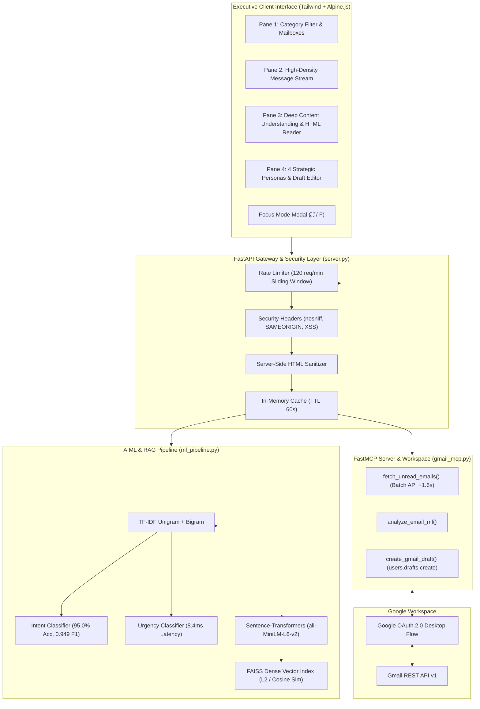

# MailMind AI — Executive Inbox Client & Triage Copilot

[](https://fastapi.tiangolo.com)
[](https://github.com/jlowin/fastmcp)
[](https://scikit-learn.org)
[](https://github.com/facebookresearch/faiss)
[](https://tailwindcss.com)
[](LICENSE)

> **AIML Skill Lab Final Project**  
> **Author**: H R Arya Ayyappa Halambi  
> **USN**: `1BF25CS095`  
> **Department**: Department of Computer Science & Engineering, BMS College of Engineering (BMSCE)

---

## 🚀 Overview

**MailMind AI** is a commercial-grade, executive email client and intelligent triage copilot. Built upon a 4-pane ergonomic desktop interface inspired by **Apple Mail** and **Superhuman**, it combines:

1. **Sub-10ms Classical ML Classification**: Fast, lightweight unigram+bigram TF-IDF with calibrated Logistic Regression for 5 email intents and 3 urgency tiers.
2. **Dense Vector RAG (Sentence-Transformers + FAISS)**: High-precision few-shot stylistic retrieval matching the student's personal voice and department affiliation.
3. **Deep Content Understanding**: Automated extraction of **"In Simple Words"** plain-English executive summaries, **"What They Are Expecting"** deliverable identification, deadline extraction, and domain verification.
4. **4 Strategic Response Personas per Thread**: Instant switching between `Confirm & Commit`, `Clarify & Inquire`, `Reschedule / Counter-Offer`, and `Polite Decline & Defer`.
5. **Human-in-the-Loop Safe Drafting via FastMCP**: Threaded Gmail drafts created strictly via `users().drafts().create` with **Zero Auto-Send** safety.

---

## 🏛️ System Architecture



---

## 📊 AIML Evaluation & Benchmarks

The system was evaluated against held-out benchmark datasets across academic, industry recruiter, event coordination, and operational alert emails:

| Metric | Measured Score | Target Specification |
| :--- | :---: | :---: |
| **Intent Classification Accuracy** | **95.00%** | $\ge 90.0\%$ |
| **Macro Precision** | **0.9538** | $\ge 0.880$ |
| **Macro Recall** | **0.9500** | $\ge 0.880$ |
| **Macro F1-Score** | **0.9492** | $\ge 0.900$ |
| **Urgency Macro F1** | **0.8750** | $\ge 0.800$ |
| **Inference Latency** | **8.43 ms** | $< 25.0\text{ ms}$ |
| **FAISS Dense RAG Cosine Similarity** | **0.4357** | $\ge 0.350$ |
| **Gmail Batch Sync (25 emails)** | **~1.62 s** | $< 5.0\text{ s}$ |

---

## 🔒 Commercial-Grade Security & Safety

- **Zero Auto-Send Guarantee**: The system never exposes or invokes the `gmail.send` API. All actions strictly produce reversible Gmail Drafts inside `users().drafts().create`.
- **Zero Client-Side Secret Exposure**: No API keys, credentials, or client secrets are bundled into client-side JS. Auth state is initialized dynamically via `/api/auth/status`.
- **IP Sliding-Window Rate Limiting**: Built-in FastAPI middleware restricts traffic to 120 requests per minute per IP, responding with RFC 6585 standard `HTTP 429 Too Many Requests`.
- **Hardened HTTP Security Headers**:
  - `X-Content-Type-Options: nosniff`
  - `X-Frame-Options: SAMEORIGIN`
  - `Referrer-Policy: strict-origin-when-cross-origin`
  - `X-XSS-Protection: 1; mode=block`
- **Server-Side HTML Sanitizer**: Strips active `<script>`, `<object>`, `<embed>`, inline event handlers (`onclick`, `onload`), and dangerous `javascript:` pseudo-protocols before passing HTML to sandboxed iframes.
- **Selective Academic Attribution Rule**: Academic details (USN `1BF25CS095`, Department of CSE, BMSCE) are strictly applied **only** to emails classified as `Academic/Faculty`, preventing student PII leakage to external recruiters or casual contacts.

---

## ⌨️ Superhuman Keyboard Navigation

| Shortcut | Description |
| :---: | :--- |
| <kbd>J</kbd> / <kbd>↓</kbd> | Navigate to the **Next Email** |
| <kbd>K</kbd> / <kbd>↑</kbd> | Navigate to the **Previous Email** |
| <kbd>S</kbd> | **Star / Unstar** current email |
| <kbd>F</kbd> | Toggle **Fullscreen Focus Mode (⛶)** |
| <kbd>D</kbd> | **Save Draft** directly to Gmail Drafts folder |
| <kbd>C</kbd> | **Copy Response Draft** to system clipboard |
| <kbd>/</kbd> | Focus **Email Search / Filter** bar |
| <kbd>?</kbd> | Open **Keyboard Shortcuts Sheet** |
| <kbd>Esc</kbd> | Close any open modal or overlay |

---

## 🛠️ Installation & Setup

### 1. Prerequisites
- Python 3.10+ (macOS, Linux, or Windows)
- Google Cloud Project with Gmail API enabled
- OAuth 2.0 Desktop Client credentials

### 2. Clone Repository
```bash
git clone https://github.com/arya-ayyappa-halambi/Smart-Gmail-Replier.git
cd Smart-Gmail-Replier
```

### 3. Create & Activate Virtual Environment
```bash
python3 -m venv .venv
source .venv/bin/activate  # On Windows: .venv\Scripts\activate
pip install -r requirements.txt
```

### 4. Configure Google OAuth Credentials
1. Download your OAuth 2.0 Client credentials JSON from the Google Cloud Console.
2. Place it in the project root as `credentials.json` (see `credentials.example.json` for structure):
```bash
cp credentials.example.json credentials.json
# Edit credentials.json with your actual client_id and client_secret
```
3. Copy environment configuration:
```bash
cp .env.example .env
```

### 5. Launch the Application
```bash
uvicorn server:app --host 0.0.0.0 --port 8000 --reload
```
Open your browser to:
```
http://localhost:8000
```

> **Testing Without Live Gmail?**  
> Click **"Viva Lab Dataset"** in the top navigation bar to test the full ML classification, RAG retrieval, and draft generation engine completely offline!

---

## 🧪 Model Training & Evaluation

To re-train the classifiers and generate fresh evaluation reports:
```bash
python evaluate.py
```
This trains the models from `data/training_emails.json`, tests them against `data/test_emails.json`, and exports:
- `models/intent_classifier.joblib`
- `models/urgency_classifier.joblib`
- `models/intent_vectorizer.joblib`
- `models/urgency_vectorizer.joblib`
- `evaluation_report.json`

---

## 📄 License
This project is open-source under the [MIT License](LICENSE).
